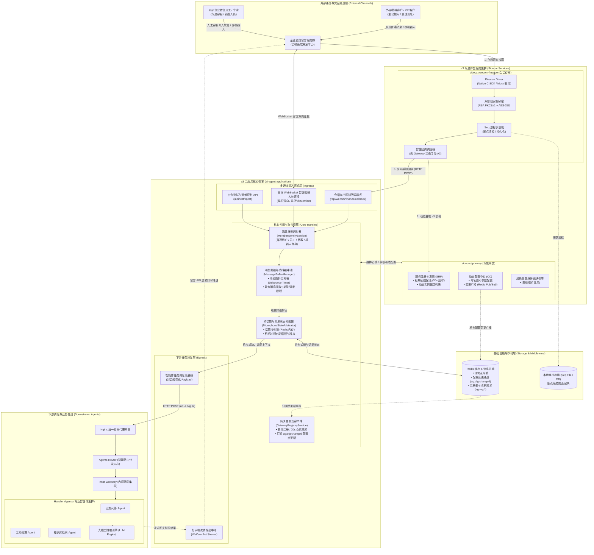
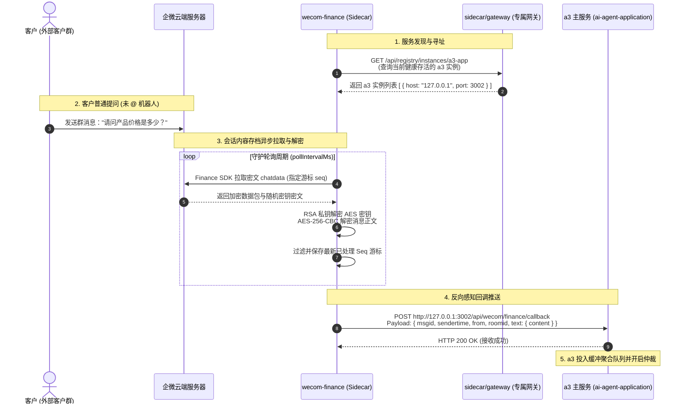
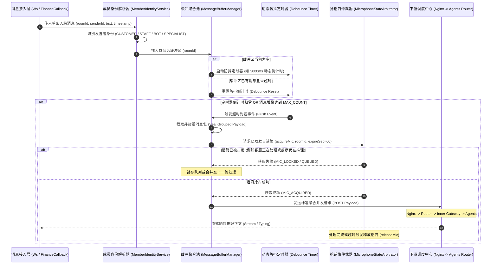
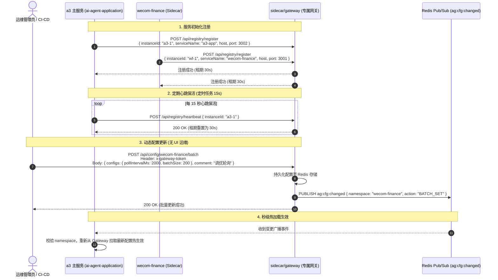

# ai-agent-application (a3) 系统整体架构设计说明书

本文档详细阐述 `ai-agent-application`（以下简称 **a3**）的系统分层架构、核心运行时机制、伴生微服务（Sidecars）协同原理以及关键业务时序流。

---

## 1. 架构演进与系统定位

根据最新系统架构规划，整体调度拓扑已演化为：

$$\text{a3 (主服务)} \longrightarrow \text{Nginx} \longrightarrow \text{Agents Router} \longrightarrow \text{Inner Gateway} \overset{\text{mult}}{\longrightarrow} \text{Handler Agents}$$

在此架构体系中，**a3 作为最前端的会话接入与多模态感知中枢**，承担企业微信多通道消息监听、客户发言缓冲聚合防抖、抢话筒并发仲裁等关键职责。为了保证 a3 进程的单一职责与高可用性，系统采用了 **Sidecar（边车伴生服务）架构模式**：
- [sidecar/gateway](file:///home/hyong/code/ai-agent/ai-agent-application/sidecar/gateway)：a3 专属服务注册与发现中心 (SRF) 及动态配置中心 (CC)。
- [sidecar/wecom-finance](file:///home/hyong/code/ai-agent/ai-agent-application/sidecar/wecom-finance)：企业微信会话内容存档 (Finance SDK) 独立拉取、解密与反向感知推送服务。

---

## 2. 完整分层全景架构图

---

## 3. 核心业务流程时序图

### 3.1 外部客户群无感发言全量感知时序图

该时序图展现客户在外部微信客户群中未主动 `@机器人` 时，系统如何通过 `wecom-finance` SDK 轮询解密，并通过专属网关动态发现 `a3` 实例完成回调推送：

---

### 3.2 消息缓冲防抖、动态封组与抢话筒仲裁时序图

展示 `a3` 收到群消息后，如何进行四层身份判定、动态防抖封组，并在并发场景下执行话筒争抢与租期释放机制：

---

### 3.3 专属网关服务注册发现 (SRF) 与配置中心 (CC) 动态同步时序图

展现系统启动、心跳维持、运维人员通过 cURL 变更参数及秒级热加载过程：

---

## 4. 伴生微服务 (Sidecars) 详细剖析与目录索引

本项目采用松耦合但紧密伴生的 Sidecar 模式设计。所有 Sidecar 均可独立启动、独立测试、独立容器化构建，并通过标准 HTTP/REST 与 Redis 与主服务协同。

### 4.1 专属服务网关：[sidecar/gateway](file:///home/hyong/code/ai-agent/ai-agent-application/sidecar/gateway)

#### 4.1.1 架构定位与核心职责
- **a3 专属服务注册中心 (SRF)**：提供微服务实例动态发现、健康状态跟踪、租期管理（默认 30s）与故障实例自动剔除。
- **动态配置中心 (CC)**：提供多命名空间（`default`、`wecom-finance`、`a3-app`）动态参数配置存储；当配置通过 API 写入后，自动通过 Redis Channel `ag:cfg:changed` 广播事件通知，使得 a3 及各组件实现免重启秒级热生效。
- **轻量级鉴权与独立部署**：内置 `x-gateway-token` 鉴权机制（[GatewayAuthGuard](file:///home/hyong/code/ai-agent/ai-agent-application/sidecar/gateway/src/auth/gateway-auth.guard.ts)），兼顾安全与无 UI 运维便捷性。

#### 4.1.2 核心代码目录与模块索引
- 网关启动入口：[src/main.ts](file:///home/hyong/code/ai-agent/ai-agent-application/sidecar/gateway/src/main.ts)
- 服务注册发现模块：[src/registry/](file:///home/hyong/code/ai-agent/ai-agent-application/sidecar/gateway/src/registry)
  - 控制器：[registry.controller.ts](file:///home/hyong/code/ai-agent/ai-agent-application/sidecar/gateway/src/registry/registry.controller.ts)
  - 核心服务：[registry.service.ts](file:///home/hyong/code/ai-agent/ai-agent-application/sidecar/gateway/src/registry/registry.service.ts)
- 动态配置中心模块：[src/config/](file:///home/hyong/code/ai-agent/ai-agent-application/sidecar/gateway/src/config)
  - 控制器：[config.controller.ts](file:///home/hyong/code/ai-agent/ai-agent-application/sidecar/gateway/src/config/config.controller.ts)
  - 核心服务：[config.service.ts](file:///home/hyong/code/ai-agent/ai-agent-application/sidecar/gateway/src/config/config.service.ts)
- 四层身份识别服务：[src/member-identity/member-identity.service.ts](file:///home/hyong/code/ai-agent/ai-agent-application/sidecar/gateway/src/member-identity/member-identity.service.ts)
- 独立 API 接口规范说明书：[sidecar/gateway/doc/API.md](file:///home/hyong/code/ai-agent/ai-agent-application/sidecar/gateway/doc/API.md)

---

### 4.2 企业微信会话存档伴生服务：[sidecar/wecom-finance](file:///home/hyong/code/ai-agent/ai-agent-application/sidecar/wecom-finance)

#### 4.2.1 架构定位与核心职责
- **全量感知外部群消息**：突破企业微信官方普通外部群未 `@机器人` 无法感知的硬性限制，以 7x24 小时独立后台常驻进程拉取企业微信合规会话存档。
- **高性能加解密与驱动抽象**：采用双阶段解密模型（RSA PKCS#1 解密随机密钥 + AES-256-CBC 解密正文）；底层提供 Native C-SDK 驱动与开箱即用的 Mock 模拟器。
- **游标持久化与断点续拉**：[SeqManager](file:///home/hyong/code/ai-agent/ai-agent-application/sidecar/wecom-finance/src/cursor/seq-manager.ts) 保证即便网络抖动或服务重启，也能从最近断点精确拉取，不重不漏。
- **自动寻址与反向回调**：与专属网关集成，动态发现 a3 实例的存活端点并进行 HTTP 反向投递。

#### 4.2.2 核心代码目录与模块索引
- 独立启动入口与守护进程：[src/index.ts](file:///home/hyong/code/ai-agent/ai-agent-application/sidecar/wecom-finance/src/index.ts)
- 会话存档 Worker 守护任务：[src/worker/finance-worker.ts](file:///home/hyong/code/ai-agent/ai-agent-application/sidecar/wecom-finance/src/worker/finance-worker.ts)
- 双阶段加解密工具：[src/crypto/finance-crypto.ts](file:///home/hyong/code/ai-agent/ai-agent-application/sidecar/wecom-finance/src/crypto/finance-crypto.ts)
- Seq 游标管理器：[src/cursor/seq-manager.ts](file:///home/hyong/code/ai-agent/ai-agent-application/sidecar/wecom-finance/src/cursor/seq-manager.ts)
- 驱动抽象层：
  - 通用接口：[src/driver/driver.interface.ts](file:///home/hyong/code/ai-agent/ai-agent-application/sidecar/wecom-finance/src/driver/driver.interface.ts)
  - 本地模拟器：[src/driver/mock-driver.ts](file:///home/hyong/code/ai-agent/ai-agent-application/sidecar/wecom-finance/src/driver/mock-driver.ts)
  - C-SDK 官方原生驱动：[src/driver/c-sdk-driver.ts](file:///home/hyong/code/ai-agent/ai-agent-application/sidecar/wecom-finance/src/driver/c-sdk-driver.ts)
- 独立 API 接口规范说明书：[sidecar/wecom-finance/doc/API.md](file:///home/hyong/code/ai-agent/ai-agent-application/sidecar/wecom-finance/doc/API.md)

---

## 5. 部署与拓扑说明

在生产容器化部署或混合架构部署时，推荐配置如下拓扑：

1. **同主机/Pod Sidecar 模式**：
   - 将 `ai-agent-application`、`sidecar/gateway`、`sidecar/wecom-finance` 作为 Pod 的多个容器协同部署，通过 `localhost` 极速通信，免去公网或复杂内网寻址损耗。
2. **多节点分布式模式**：
   - 依赖集中式 Redis 保证网关注册中心健康表及分布式配置广播实时同步。
   - a3 通过配置环境变量 `GATEWAY_ENABLED=true`、`GATEWAY_URL=http://<gateway-host>:<port>` 接入网关，以无状态模式横向扩容。
