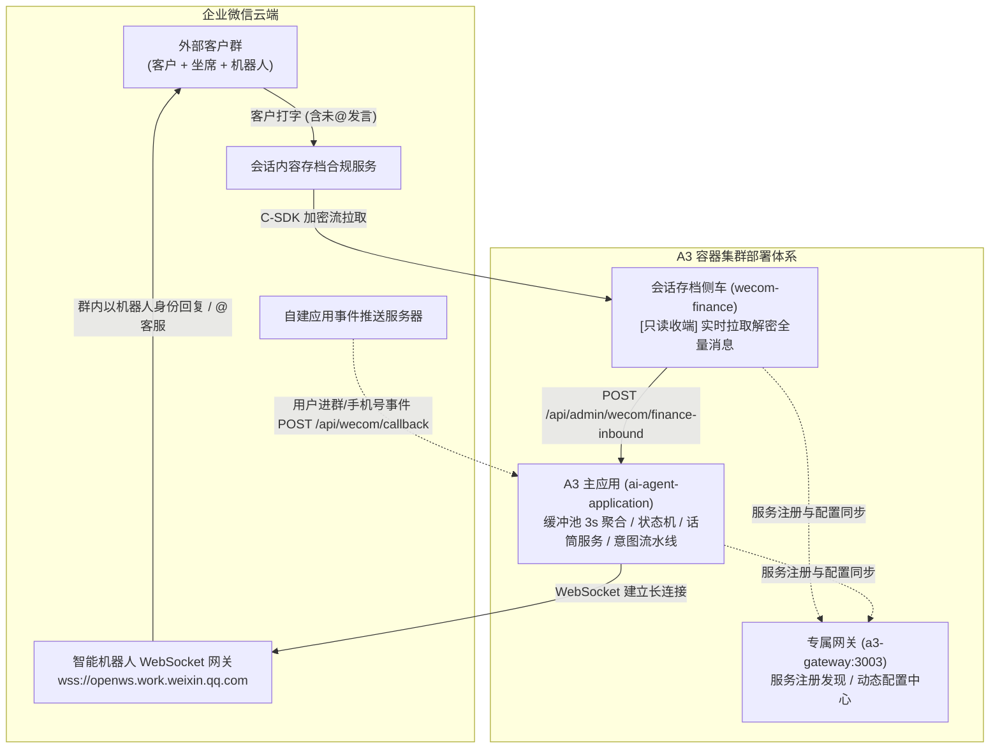

# 企业微信正式调试与全链路配置指南

本文档为 A3 智能体平台（`ai-agent-application`）对接企业微信（WeCom）的官方调试与配置实操手册。旨在指导开发与运维人员在真实企业微信环境中快速建立通信、排查异常并完成端到端联调。

---

## 目录
- [一、 企业微信通信双轨制架构](#一-企业微信通信双轨制架构)
- [二、 阶段一：智能机器人长连接极速调试（推荐首选，零公网门槛）](#二-阶段一智能机器人长连接极速调试推荐首选零公网门槛)
  - [1. 企微管理后台获取凭证](#1-企微管理后台获取凭证)
  - [2. 配置本地环境变量](#2-配置本地环境变量)
  - [3. 部署并验证连接状态](#3-部署并验证连接状态)
- [三、 阶段二：会话内容存档 Sidecar 调试（全量消息捕获 + 抢话筒）](#三-阶段二会话内容存档-sidecar-调试全量消息捕获--抢话筒)
  - [1. 企微管理后台开通与凭证](#1-企微管理后台开通与凭证)
  - [2. 生成 RSA-2048 密码学密钥对](#2-生成-rsa-2048-密码学密钥对)
  - [3. 获取官方 Linux 原生 C-SDK 动态库](#3-获取官方-linux-原生-c-sdk-动态库)
  - [4. 配置 Sidecar 环境变量](#4-配置-sidecar-环境变量)
  - [5. 启动与日志观测](#5-启动与日志观测)
- [四、 阶段三：自建应用接收事件服务器回调（可选/进阶）](#四-阶段三自建应用接收事件服务器回调可选进阶)
  - [1. 企微后台配置回调 URL](#1-企微后台配置回调-url)
  - [2. A3 本地环境变量同步](#2-a3-本地环境变量同步)
  - [3. 保存并触发 URL 有效性验签](#3-保存并触发-url-有效性验签)
- [五、 端到端实战联调步骤与排障矩阵](#五-端到端实战联调步骤与排障矩阵)
  - [1. 推荐调试步骤](#1-推荐调试步骤)
  - [2. 常见问题排查速查表](#2-常见问题排查速查表)

---

## 一、 企业微信通信双轨制架构

在外部客户群中，为满足客户日常不 @ 机器人打字提问的自然习惯，同时保证我方客服主动发言时机器人立刻停止抢答（抢占话筒），A3 采用了**双轨制组合架构**：



---

## 二、 阶段一：智能机器人长连接极速调试（推荐首选，零公网门槛）

> 💡 **核心优势**：
> - **不需要公网 IP**
> - **不需要独立域名与备案**
> - **不需要配置 SSL 证书与 Nginx 反向代理**  
> 开发机连接公司内网或日常 Wi-Fi，即可通过 WebSocket 出站直连腾讯官方云端网关，5 分钟内完成在真实群内的双向收发测试。

### 1. 企微管理后台获取凭证
1. 使用企业管理员账号登录 [企业微信管理后台](https://work.weixin.qq.com/)；
2. 导航至 **【应用管理】** $\rightarrow$ **【机器人】**；
3. 创建“智能机器人”（例如“延保方案助手”）；
4. 获取关键凭证：
   - **`Bot ID`**（机器人唯一 ID）
   - **`Secret`**（机器人认证通信密钥）

### 2. 配置本地环境变量
在 `ai-agent-application/.env.local` 文件中填入（该文件受 `.gitignore` 保护）：

```bash
# ==============================================================================
# 企微智能机器人 (长连接模式)
# ==============================================================================
WECOM_BOT_ENABLED=true
WECOM_BOT_ID=你的_Bot_ID_在此
WECOM_BOT_SECRET=你的_Bot_Secret_在此
WECOM_BOT_WS_URL=wss://openws.work.weixin.qq.com

# 转人工时群内 @ 的客服人员 (可填客服真实企微 UserID，或保持默认 @客服)
WECOM_STAFF_MENTIONS=@客服

# 关联的业务租户 ID (默认 1)
WECOM_TENANT_ID=1
```

### 3. 部署并验证连接状态
运行部署器热更新 A3 主容器：
```bash
./deploy.sh deploy local app
```
或直接通过命令行执行：
```bash
docker logs -f a3-app-local
```
**成功标志**：
日志中出现以下高亮输出，代表长连接认证成功：
```text
[WecomBotService] 正在初始化企业微信智能机器人长连接客户端 (Bot ID: bot_******)...
[WecomBotService] 企业微信 WebSocket 底层连接建立成功 (connected)
[WecomBotService] 🎉 企业微信智能机器人认证成功！长连接已就绪 (authenticated)
```
**群内联调**：将机器人添加到测试外部群中，在群内发送 `@机器人 你好`，A3 将捕获并进行智能答复。

---

## 三、 阶段二：会话内容存档 Sidecar 调试（全量消息捕获 + 抢话筒）

用于在外部客户群中监听**客户直接提问（未 @ 机器人）**，以及**客服主动打字发言自动抢走话筒**。

### 1. 企微管理后台开通与凭证
1. 管理员在企微后台开通 **【管理工具】** $\rightarrow$ **【会话内容存档】**；
2. 记录 **`WECOM_CORPID`**（企业 ID，以 `ww` 开头）与 **`WECOM_CHATDATA_SECRET`**（会话存档专用 Secret，具有高敏感权限）；
3. 在【开启范围】中将参与测试的员工（客服/销售账号）勾选加入。

### 2. 生成 RSA-2048 密码学密钥对
企业微信会话存档采用非对称加密存储消息，需本地生成 RSA 私钥并将公钥上传到后台：

```bash
# 进入侧车密钥目录
mkdir -p sidecar/wecom-finance/keys

# 1. 生成 2048 位私钥 (PEM 格式)
openssl genrsa -out sidecar/wecom-finance/keys/private.pem 2048

# 2. 从私钥导出对应的公钥
openssl rsa -in sidecar/wecom-finance/keys/private.pem -pubout -out sidecar/wecom-finance/keys/public.pem
```
- 打开 `public.pem`，将其完整内容复制并粘贴到企业微信后台会话存档配置页的**公钥设置**中；
- 企微后台保存后会生成一个**公钥版本号**（记录备用）。

### 3. 获取官方 Linux 原生 C-SDK 动态库
从企业微信开发者官网下载官方 C-SDK 库，并将 `libWeWorkFinanceSdk_C.so` 放置于：
```text
sidecar/wecom-finance/lib/libWeWorkFinanceSdk_C.so
```
*(注：本地无真实企业资质开发时，可直接使用 `FINANCE_DRIVER_MODE=mock` 模式，系统自带仿真加解密数据流驱动，无需官方 C 库即可完整验证全链路逻辑)*。

### 4. 配置 Sidecar 环境变量
在 `sidecar/wecom-finance/.env.local` 或 `sidecar/wecom-finance/.env` 中配置：

```bash
# 企业 CorpID 与会话存档专属 Secret
WECOM_CORPID=ww1234567890abcdef
WECOM_CHATDATA_SECRET=你的_CHATDATA_SECRET

# 驱动模式 (开发阶段建议 mock，具备真实资质切换为 native)
FINANCE_DRIVER_MODE=native

# 本地私钥与动态库路径
RSA_PRIVATE_KEY_PATH=./keys/private.pem
WECOM_C_SDK_LIB_PATH=./lib/libWeWorkFinanceSdk_C.so

# 轮询参数
POLL_INTERVAL_MS=1000
BATCH_SIZE=100
CURSOR_STORAGE_PATH=./data/seq.cursor

# 投递目标 (容器内网络直连 A3 容器: a3-app)
A3_WEBHOOK_URL=http://a3-app:3002/api/admin/wecom/finance-inbound
A3_WEBHOOK_SECRET=agent_finance_sidecar_token_2026
```

同时确保 `ai-agent-application/.env.local` 中配置一致的内部安全令牌：
```bash
WECOM_SIDECAR_TOKEN=agent_finance_sidecar_token_2026
```

### 5. 启动与日志观测
```bash
./deploy.sh deploy local finance
```
查看 Sidecar 容器运行状态与拉取日志：
```bash
docker logs -f a3-finance-local
```
**成功标志**：
```text
[FinanceWorker] 启动会话内容存档守护进程: 模式=native, 当前游标Seq=..., 轮询间隔=1000ms
[FinanceWorker] 本批次拉取到 N 条加密消息 (游标起点: ...)
[FinanceWorker][收到全量消息] Seq=... | 房间=... | 发送人=... | 类型=text | 动作=send
[HttpDispatcher] 成功分发至 A3: Seq=..., 耗时=...ms
```

---

## 四、 阶段三：自建应用接收事件服务器回调（可选/进阶）

用于接收客户入群通知、员工成员变更、客户授权手机号等事件。

### 1. 企微后台配置回调 URL
1. 进入企微后台 **【应用管理】** $\rightarrow$ **【自建应用】**；
2. 找到应用并点击 **【API 接收消息 / 设置接收事件服务器】**；
3. 填写配置项：
   - **URL**：`https://<你的公网域名>/api/wecom/callback`（要求公网 80/443 可通）
   - **Token**：自定义签名令牌（如点击随机生成）
   - **EncodingAESKey**：43 位消息加解密密钥（点击随机生成）

### 2. A3 本地环境变量同步
将企微后台生成的参数填入 `ai-agent-application/.env.local`：

```bash
WECOM_CORPID=ww1234567890abcdef
WECOM_CALLBACK_TOKEN=你在后台配置的Token
WECOM_CALLBACK_AES_KEY=你在后台配置的43位EncodingAESKey
```

### 3. 保存并触发 URL 有效性验签
在企微后台点击 **【保存】**。企微将发送 `GET` 请求至该 URL。A3 的 `WecomCallbackController` 会自动使用 `EncodingAESKey` 解密 `echostr` 并原样返回。后台显示“保存成功”即代表配置完成。

---

## 五、 端到端实战联调步骤与排障矩阵

### 1. 推荐调试步骤

| 顺序 | 步骤说明 | 操作与判定依据 |
| :---: | :--- | :--- |
| **1** | **长连接探活** | 仅配置 `WECOM_BOT_ID` + `WECOM_BOT_SECRET`，启动 A3 容器，观察日志显示 `长连接已就绪 (authenticated)`。 |
| **2** | **群内点对点提问** | 在外部群内输入 `@机器人 你的业务问题`，验证 A3 流水线从接收、缓冲、决策到下发回答全链路。 |
| **3** | **话筒抢夺测试** | 客服人员在群内直接发送解答（不 @ 机器人），观察 A3 日志打印 `Microphone: 话筒被抢占`，在途回答被安全掐断作废。 |
| **4** | **话筒接回测试** | 客服在群内发言 `@机器人 请接手`，观察 A3 日志打印 `Microphone: 话筒已交还给 BOT`，后续客户消息恢复自动应答。 |

### 2. 常见问题排查速查表

| 常见报错 / 异常现象 | 可能原因 | 解决办法 |
| :--- | :--- | :--- |
| **`WebSocket 断开: 40014 / 40001`** | `WECOM_BOT_SECRET` 填写错误或与 `Bot ID` 不匹配 | 登录企微管理后台，重新确认机器人 Secret，更新 `.env.local` 后重启容器。 |
| **群内 @ 机器人没有任何反应** | 1. 发言人被系统识别为员工（`STAFF_CS` 或 `STAFF_OTHER`）<br/>2. 话筒处于人工客服持有状态（`HUMAN`） | 系统防抢跑设计规定**不对内部员工普通提问自动应答**。可在网关接口 `GET /api/registry/services` 或数据库 `wecom_member_role` 确认发言人身份；或者让客户真实微信账号提问。 |
| **`Finance Sidecar 报 80001 / 80003`** | `WECOM_CHATDATA_SECRET` 填写错误或 RSA 私钥与企微后台公钥版本不匹配 | 1. 检查 Secret 是否为会话存档专属 Secret（非普通应用 Secret）；<br/>2. 确认 `keys/private.pem` 与企微后台上传的公钥是一对生成的。 |
| **回调 URL 验签失败 (`400 Bad Request`)** | 企微后台发送的 `Token` 或 `EncodingAESKey` 与 `.env.local` 不一致 | 核对 `WECOM_CALLBACK_TOKEN` 与 `WECOM_CALLBACK_AES_KEY` 字符，注意首尾不要带有空格。 |
| **容器无法连通宿主机 Redis/MySQL** | 容器处于独立隔离 Docker 网络中 | 部署脚本已内置自动双网络桥接，运行 `./deploy.sh deploy local app` 将自动挂载到 `agent-platform_default`。 |
