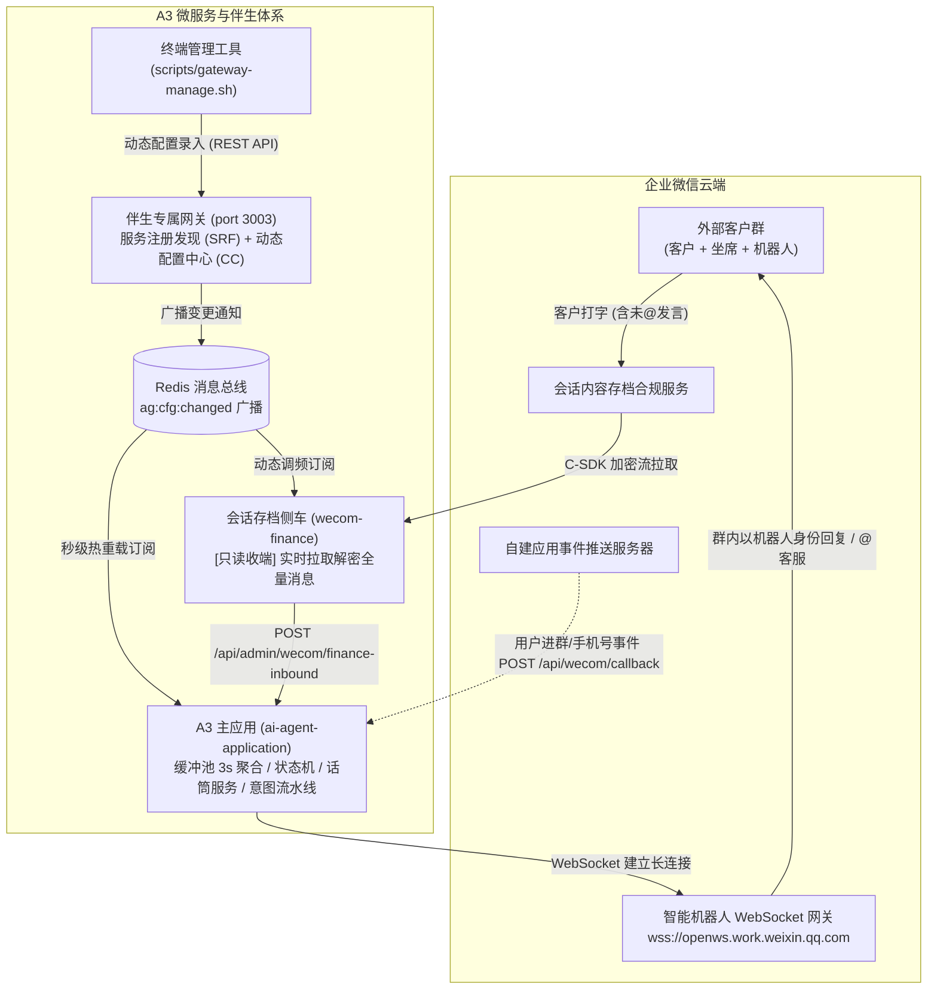

# 企业微信正式调试与全链路配置指南

本文档为 A3 智能体平台（`ai-agent-application`）对接企业微信（WeCom）的官方调试与配置实操手册。基于**专属网关动态配置中心 (CC)** 架构设计，指导开发与运维人员在真实企业微信环境中快速建立通信、通过终端管理工具动态热更凭证、并完成端到端联调。

---

## 目录
- [一、 企业微信通信双轨制与动态配置架构](#一-企业微信通信双轨制与动态配置架构)
- [二、 终端管理工具 (gateway-manage.sh) 快速上手](#二-终端管理工具-gateway-managesh-快速上手)
- [三、 阶段一：智能机器人长连接极速调试（推荐首选，零公网门槛）](#三-阶段一智能机器人长连接极速调试推荐首选零公网门槛)
  - [1. 企微管理后台获取凭证](#1-企微管理后台获取凭证)
  - [2. 动态录入机器人凭证 (无需重启)](#2-动态录入机器人凭证-无需重启)
  - [3. 验证长连接状态与动态生效日志](#3-验证长连接状态与动态生效日志)
- [四、 阶段二：会话内容存档 Sidecar 调试（全量消息捕获 + 抢话筒）](#四-阶段二会话内容存档-sidecar-调试全量消息捕获--抢话筒)
  - [1. 企微管理后台开通与凭证](#1-企微管理后台开通与凭证)
  - [2. 生成 RSA-2048 密钥对](#2-生成-rsa-2048-密钥对)
  - [3. 获取官方 Linux 原生 C-SDK 动态库](#3-获取官方-linux-原生-c-sdk-动态库)
  - [4. 动态下发会话存档参数与在线调频](#4-动态下发会话存档参数与在线调频)
- [五、 阶段三：自建应用接收事件服务器回调（可选/进阶）](#五-阶段三自建应用接收事件服务器回调可选进阶)
  - [1. 企微后台配置回调 URL](#1-企微后台配置回调-url)
  - [2. 动态下发回调验签与解密密钥](#2-动态下发回调验签与解密密钥)
  - [3. 保存并触发 URL 有效性验签](#3-保存并触发-url-有效性验签)
- [六、 端到端实战联调步骤与排障矩阵](#六-端到端实战联调步骤与排障矩阵)

---

## 一、 企业微信通信双轨制与动态配置架构

在外部客户群中，为满足客户日常不 @ 机器人打字提问的自然习惯，同时保证我方客服主动发言时机器人立刻停止抢答（抢占话筒），A3 采用了**双轨制组合架构**，并通过**伴生网关动态配置中心 (CC)** 实现所有凭证与流控参数的免重启秒级热生效：



---

## 二、 终端管理工具 (gateway-manage.sh) 快速上手

A3 提供了专属终端管理控制台，无需打开 Web 浏览器或启动前端控制台即可完成全套运维操作：

### 1. 交互式菜单模式 (TUI)
在 `ai-agent-application` 项目根目录下直接运行：
```bash
./scripts/gateway-manage.sh
```
将展现自述化数字菜单：
```text
================================================================
       A3 伴生网关 (Sidecar Gateway) 终端管理控制台             
================================================================
网关地址: http://127.0.0.1:3003  |  Token 状态: [已加载鉴权 Token]

  [1] 服务发现: 查看已注册微服务与健康实例 (SRF)
  [2] 配置中心: 列出所有命名空间与配置项总览 (CC)
  [3] 配置中心: 查看某命名空间详细配置
  [4] 企微助手: 交互式录入/更新企业微信机器人凭证 (wecom)
  [5] 流控助手: 交互式调节运行态静默/熔断/话筒参数 (runtime)
  [6] 侧车助手: 交互式调节会话存档参数 (wecom-finance)
  [7] 高级管理: 手动设置/修改任意单项配置
  [8] 高级管理: 删除指定配置项或清空命名空间
  [9] 接口手册: 检索网关自省手册与出入参说明 (Manual)
  [h] 健康状态: 查看网关实时健康检查
  [0] 退出控制台
----------------------------------------------------------------
```

### 2. 命令行快捷模式 (CLI)
适合单行调试或脚本化执行：
```bash
# 查看当前企微配置
./scripts/gateway-manage.sh wecom get

# 查看微服务注册实例
./scripts/gateway-manage.sh registry list

# 查看网关健康状态
./scripts/gateway-manage.sh health
```

---

## 三、 阶段一：智能机器人长连接极速调试（推荐首选，零公网门槛）

> 💡 **核心优势**：
> - **不需要公网 IP**
> - **不需要独立域名与备案**
> - **不需要配置 SSL 证书与 Nginx 反向代理**  
> 开发机连接公司内网或日常 Wi-Fi，即可通过 WebSocket 出站直连腾讯官方云端网关，5 分钟内完成在真实群内的双向收发测试。

### 1. 企微管理后台获取凭证
1. 使用企业管理员账号登录 [企业微信管理后台](https://work.weixin.qq.com/)；
2. 导航至 **【应用管理】** $\rightarrow$ **【机器人】**；
3. 创建“智能机器人”（例如“延保方案助手”）；
4. 获取关键凭证：
   - **`Bot ID`**（机器人唯一 ID）
   - **`Secret`**（机器人认证通信密钥）

### 2. 动态录入机器人凭证 (无需重启)

使用终端管理工具一键动态生效：
```bash
./scripts/gateway-manage.sh wecom set \
  --bot-id "你的_Bot_ID" \
  --bot-secret "你的_Bot_Secret" \
  --ws-url "wss://openws.work.weixin.qq.com" \
  --staff-mentions "@客服" \
  --enabled "true"
```

> **或者使用底层 HTTP cURL 写入网关 CC**：
> ```bash
> curl -X POST http://localhost:3003/api/config/wecom/batch \
>   -H "Content-Type: application/json" \
>   -d '{
>     "configs": {
>       "botId": "你的_Bot_ID",
>       "botSecret": "你的_Bot_Secret",
>       "botWsUrl": "wss://openws.work.weixin.qq.com",
>       "staffMentions": "@客服",
>       "botEnabled": true
>     },
>     "comment": "调试环境企微机器人凭证上线"
>   }'
> ```

### 3. 验证长连接状态与动态生效日志
配置写入后，网关立刻通过 Redis Channel `ag:cfg:changed` 广播变更通知，A3 主应用在**无需重启容器**的前提下秒级完成长连接热重载。

观察 A3 服务日志：
```text
[GatewayConfigService] [配置中心] 监听到变更广播 [wecom.botId] v2，触发热重载...
[WecomBotService] 收到企微配置变更通知 (botId)，检查并执行热重载...
[WecomBotService] 检测到企业微信长连接参数变更，正在平滑重启长连接...
[WecomBotService] 正在初始化企业微信智能机器人长连接客户端 (Bot ID: wx89****8821)...
[WecomBotService] 企业微信 WebSocket 底层连接建立成功 (connected)
[WecomBotService] 🎉 企业微信智能机器人认证成功！长连接已就绪 (authenticated)
```

验证运行时状态：
```bash
curl http://localhost:3002/api/wecom/status
# 返回: {"success":true,"data":{"configured":true,"enabled":true,"connected":true,"authenticated":true,"botId":"wx89****8821"}}
```

---

## 四、 阶段二：会话内容存档 Sidecar 调试（全量消息捕获 + 抢话筒）

智能机器人的 WebSocket 默认只能收到客户显式 @机器人的发言。如果业务需要**捕获客户在外部群里的所有打字提问（不@也能答）**，以及**识别员工发言以自动交还话筒**，必须开启阶段二的会话存档侧车。

### 1. 企微管理后台开通与凭证
1. 登录企微后台 $\rightarrow$ **【管理工具】** $\rightarrow$ **【会话内容存档】**；
2. 确保版本为**服务版**或**企业版**，并购买了相应坐席账号许可；
3. 将调试涉及的内部客服坐席加入“开启范围”；
4. 记录会话存档专属 **Secret**。

### 2. 生成 RSA-2048 密钥对
企微会话存档数据在云端使用企业公钥高强度加密，拉取后需由企业本地私钥解密：
```bash
# 进入侧车目录生成标准密钥对
cd sidecar/wecom-finance
mkdir -p keys
openssl genrsa -out keys/private.pem 2048
openssl rsa -in keys/private.pem -pubout -out keys/public.pem
```
登录企微后台，将生成的 `keys/public.pem` 内容复制粘贴到“设置公钥”处，并记下企微分配的**公钥版本号（Key Version）**。

### 3. 获取官方 Linux 原生 C-SDK 动态库
从腾讯企微官方开放平台下载 Linux 64位动态库（`libWeWorkFinanceSdk_C.so`），放置于：
```text
sidecar/wecom-finance/lib/libWeWorkFinanceSdk_C.so
```
*(本地 Mock 联调模式下可无需该库，系统会自动模拟全量消息流)*。

### 4. 动态下发会话存档参数与在线调频

使用终端管理工具下发会话存档配置：
```bash
./scripts/gateway-manage.sh config batch wecom-finance '{
  "corpid": "你的_CorpID",
  "secret": "你的_ChatData_Secret",
  "pollIntervalMs": 1000,
  "batchSize": 100,
  "driverMode": "mock"
}' "更新会话存档参数"
```

**在线调频**：如果在高并发或压测场景需要加快拉取频率，无需重启侧车，直接执行：
```bash
./scripts/gateway-manage.sh config set wecom-finance pollIntervalMs 500 "提速轮询至500ms"
```
侧车 `wecom-finance` 将立即输出：
```text
[GatewayClient][CC] 监听到命名空间 [wecom-finance] 配置变更通知 (v3)，触发热重载...
[FinanceWorker] 收到网关配置热更: 轮询间隔=500ms, 批次大小=100
```

---

## 五、 阶段三：自建应用接收事件服务器回调（可选/进阶）

用于实时接收用户进群、退群、或者企微打通绑定的**客户手机号更新事件**。

### 1. 企微后台配置回调 URL
1. 登录企微后台 $\rightarrow$ **【应用管理】** $\rightarrow$ 进入自建应用；
2. 找到 **【接收消息】** / **【API接收消息】**，点击“设置 API 接收”；
3. **URL** 填入你的公网回调地址（格式：`http(s)://你的公网域名/api/wecom/callback`）；
4. 点击“随机获取”生成 **Token** 和 **EncodingAESKey**（暂不点击保存）。

### 2. 动态下发回调验签与解密密钥

使用终端管理工具将后台生成的密钥动态写入网关：
```bash
./scripts/gateway-manage.sh wecom set \
  --callback-token "后台生成的Token" \
  --callback-aes-key "后台生成的EncodingAESKey" \
  --corpid "你的CorpID"
```

### 3. 保存并触发 URL 有效性验签
返回企微后台点击 **【保存】**。企微将发起 `GET /api/wecom/callback` 请求进行验签。  
A3 会自动以刚写入的最新 Token 与 AESKey 完成解密并回显明文，企微后台提示“保存成功”。

---

## 六、 端到端实战联调步骤与排障矩阵

### 1. 推荐调试步骤
1. **拉起基础网关与服务**：运行 `./scripts/deploy.sh` 确保网关（3003）与 A3（3002）健康运行；
2. **终端配置企微**：执行 `./scripts/gateway-manage.sh wecom set --bot-id xxx --bot-secret yyy`；
3. **观察热更新日志**：确认控制台打印 `🎉 企业微信智能机器人认证成功！长连接已就绪`；
4. **群聊真实发问**：在企微群中 `@机器人 你好`，观察群内机器人是否在 1~3 秒内智能输出应答；
5. **客服人工抢话筒测试**：群内客服打字发言，观察 A3 后台日志是否立即触发抢占话筒，机器人暂停抢答并释放发言权。

### 2. 常见问题排查速查表

| 现象 | 可能原因 | 解决排查手段 |
| :--- | :--- | :--- |
| 执行 `manage.sh` 提示 `无法连接到伴生网关服务` | 网关容器未启动或端口映射不一致 | 检查 `./scripts/deploy.sh status`，确认 `sidecar-gateway` 运行中并监听 3003 端口 |
| 机器人长连接建立失败 `connect ECONNREFUSED` | 机器网络无法出站访问腾讯网关 | 检查本机 DNS 或防火墙，确认是否能正常解析 `openws.work.weixin.qq.com:443` |
| 动态录入配置后 A3 未热重载 | Redis 未连通或广播频道未订阅 | 检查 `ai-agent-application` 日志是否包含 `成功订阅配置变更频道 [ag:cfg:changed]` |
| 企微后台保存回调 URL 报“验签失败” | Token / AESKey 录入错误或不匹配 | 使用 `./scripts/gateway-manage.sh wecom get` 仔细核对参数长度与字面量 |
| 会话存档侧车报错 `libWeWorkFinanceSdk_C.so not found` | 动态链接库文件不存在或架构不匹配 | 确认动态库为 Linux 64 位 x86_64 glibc 版本，且挂载至侧车对应路径 |
