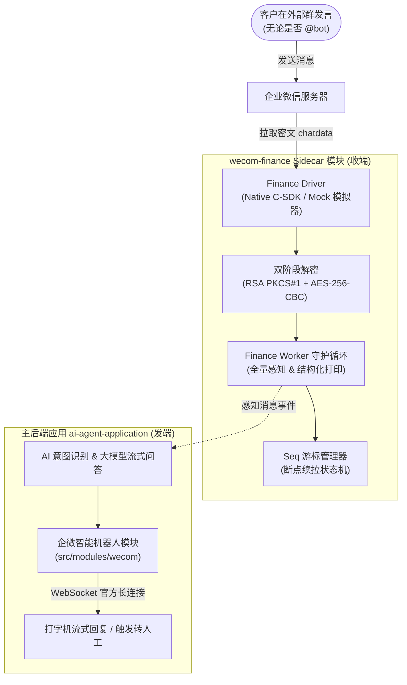

# 企业微信会话内容存档 (Finance SDK) 独立 Sidecar 模块

该模块作为技术开发方案（§11.1 C1 指标）中外部客户群全量消息感知的核心组件，以独立 Sidecar 进程形式 7x24 小时运行，专门解决**“客户在外部群发送任意消息（未 @ 机器人）时系统无法感知”**的官方限制。

---

## 架构协同图 (R1 + R2)



---

## 目录结构

```text
sidecar/wecom-finance/
├── Dockerfile                  # 独立容器化镜像定义（基于 Debian glibc）
├── package.json                # 独立依赖与 npm 脚本
├── tsconfig.json               # TypeScript 编译配置
├── .env.example                # 环境变量配置模板
├── .gitignore                  # 凭证、私钥与持久化游标安全隔离
├── README.md                   # 模块使用与生产部署指南
├── src/
│   ├── index.ts                # 独立启动入口与优雅停机（SIGINT/SIGTERM）
│   ├── types/
│   │   └── finance.types.ts    # 企微存档协议、解密消息与配置类型定义
│   ├── crypto/
│   │   └── finance-crypto.ts   # RSA 随机密钥解密 + AES-256-CBC 正文双阶段解密
│   ├── cursor/
│   │   └── seq-manager.ts      # 游标原子持久化与断点续拉状态机
│   ├── driver/
│   │   ├── driver.interface.ts # 驱动通用抽象接口
│   │   ├── mock-driver.ts      # 本地模拟器（自动生成加解密流，开箱即用）
│   │   └── native-driver.ts    # 生产企微 C 动态库对接驱动
│   └── worker/
│       └── finance-worker.ts   # 长轮询拉取守护工作进程与异常指数退避
└── test/
    └── finance.spec.ts         # 密码学、游标与轮询全流程单元测试套件
```

---

## 环境变量配置

复制 `.env.example` 为 `.env`：

```bash
cp .env.example .env
```

| 变量名 | 说明 | 默认值 / 示例 |
| :--- | :--- | :--- |
| `FINANCE_DRIVER_MODE` | 运行模式：`mock`（本地模拟）或 `native`（生产环境） | `mock` |
| `WECOM_CORPID` | 企业微信企业 ID（CorpID） | `ww1234567890abcdef` |
| `WECOM_CHATDATA_SECRET` | 会话内容存档 Secret | `your_secret` |
| `RSA_PRIVATE_KEY_PATH` | 企业 RSA 私钥路径（生产环境必填） | `./keys/private.pem` |
| `RSA_PRIVATE_KEY_PASSPHRASE` | RSA 私钥密码（若有） | 空 |
| `POLL_INTERVAL_MS` | 轮询拉取间隔（毫秒） | `1000` |
| `BATCH_SIZE` | 单批次最大拉取数量（最大 1000） | `100` |
| `CURSOR_STORAGE_PATH` | 游标持久化文件路径 | `./data/seq.cursor` |
| `WECOM_C_SDK_LIB_PATH` | 原生 C 动态库路径（仅 native 模式） | `./lib/libWeWorkFinanceSdk_C.so` |

---

## 本地开发与测试

### 1. 模拟模式（Mock Mode，开箱即用）

无需配置真实企业微信会话存档资质或 C 动态库：
```bash
# 启动 Sidecar
npm run dev
# 或直接启动编译后的代码
npm run build && npm start
```
- 控制台将自动在内存中生成 2048 位 RSA 密钥对；
- 自动模拟持续生成的外部客户群消息（文本、语音等）；
- 自动执行完整的 RSA + AES 真实双重解密，并打印结构化感知日志；
- 自动在 `./data/seq.cursor` 中推进游标。

### 2. 运行单元测试与类型检查

```bash
# 执行单元测试
npm test

# 执行类型检查
npm run typecheck
```

---

## 容器化部署指南（deploy.sh）

本项目提供了一键化部署脚本 `deploy.sh`，支持隔离的 **本地开发环境 (`local`)**、**测试环境 (`test`)** 与 **生产环境 (`prod`)**。

### 1. 本地容器化联调（Local 模式）

本地模式读取 [.env.local](file:///home/hyong/code/ai-agent/ai-agent-application/sidecar/wecom-finance/.env.local)（若无则自动回退至 [.env.dev](file:///home/hyong/code/ai-agent/ai-agent-application/sidecar/wecom-finance/.env.dev)）。
脚本已自动挂载 `host.docker.internal:host-gateway`，容器内可通过 `http://host.docker.internal:3002/...` 顺畅访问在宿主机上运行的 a3 后端：

```bash
# 一键构建镜像并启动本地开发容器
./deploy.sh deploy local
# 或使用 npm
npm run deploy:local

# 查看实时日志
./deploy.sh logs local

# 检查容器状态
./deploy.sh status local

# 停止并清理本地容器
./deploy.sh stop local
```

---

### 2. 测试环境部署（Test 模式 / Mock 开箱即用）

测试环境采用 [.env.test](file:///home/hyong/code/ai-agent/ai-agent-application/sidecar/wecom-finance/.env.test) 配置，无需真实企微秘钥或 C 动态库，开箱即用：

```bash
# 一键构建镜像并启动测试容器
./deploy.sh deploy test
# 或使用 npm
npm run deploy:test

# 查看实时日志
./deploy.sh logs test

# 检查容器运行状态
./deploy.sh status test

# 停止并清理测试容器
./deploy.sh stop test
```

---

### 3. 生产环境部署（Prod 模式 / Native 模式）

1. **企业资质准备**：
   - 在企业微信管理后台开通“会话内容存档”功能，设置好公钥（保留配对的本地 RSA 私钥）。
   - 获取企业管理凭据 `CorpID` 和 `ChatDataSecret`。
2. **放置 C 动态库与私钥**：
   - 从企微官方下载对应 Linux glibc 平台的 `libWeWorkFinanceSdk_C.so`，放入 `lib/` 目录。
   - 将企业 RSA 私钥保存为 `keys/private.pem`（建议执行 `chmod 600 keys/private.pem`）。
3. **配置生产环境变量**：
   ```bash
   cp .env.prod.example .env.prod
   # 编辑 .env.prod，填入真实的 WECOM_CORPID、WECOM_CHATDATA_SECRET 及 A3_WEBHOOK_SECRET
   vim .env.prod
   ```
4. **一键发布上线**：
   ```bash
   # 一键构建并启动生产容器
   ./deploy.sh deploy prod
   # 或使用 npm
   npm run deploy:prod

   # 查看生产运行日志
   ./deploy.sh logs prod

   # 停止生产容器
   ./deploy.sh stop prod
   ```

---

### 4. deploy.sh 常用命令汇总

| 命令 | 说明 | 对应 npm 脚本 |
| :--- | :--- | :--- |
| `./deploy.sh deploy local` | 构建并部署本地开发容器 | `npm run deploy:local` |
| `./deploy.sh deploy test` | 构建并部署测试容器（默认） | `npm run deploy:test` |
| `./deploy.sh deploy prod` | 构建并部署生产容器 | `npm run deploy:prod` |
| `./deploy.sh logs local` | 追踪本地开发容器日志 | `npm run logs:local` |
| `./deploy.sh logs test` | 追踪测试容器实时输出 | `npm run logs:test` |
| `./deploy.sh logs prod` | 追踪生产容器实时输出 | `npm run logs:prod` |
| `./deploy.sh status local` | 查看本地容器状态 | - |
| `./deploy.sh status test` | 查看测试容器状态 | `npm run status` |
| `./deploy.sh stop local` | 停止并移除本地容器 | `npm run stop:local` |
| `./deploy.sh stop prod` | 停止并移除生产容器 | `npm run stop:prod` |
| `./deploy.sh build prod` | 仅重新构建 Docker 镜像 | - |
| `./deploy.sh help` | 查看帮助说明 | - |

