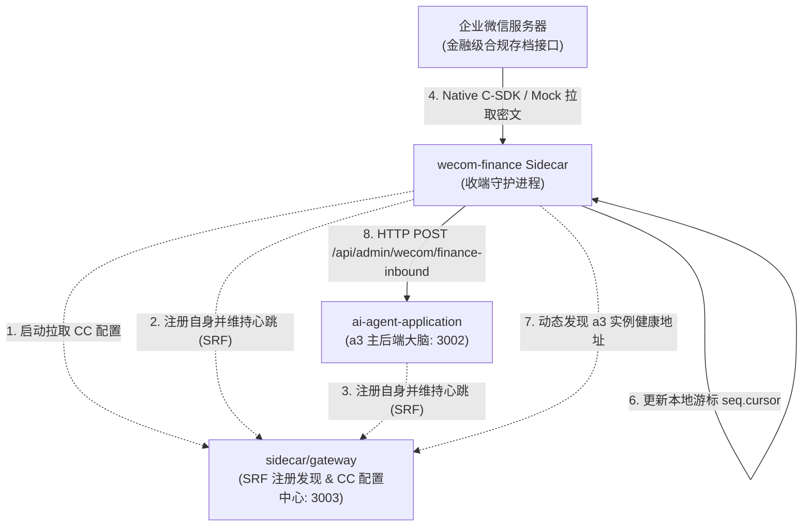

# 企业微信会话内容存档 (wecom-finance) Sidecar API 规范与协议文档

该文档为 `ai-agent-application/sidecar/wecom-finance` 微服务组件的官方通信与协议规范。该 Sidecar 以独立容器/进程模式 7x24 小时运行，专门解决**“客户在外部群发送任意消息（未 @ 机器人）时系统无法感知”**的官方限制。

---

## 目录
- [一、 模块通信全景与数据流](#一-模块通信全景与数据流)
- [二、 下行投递：a3 Webhook 回调协议规范](#二-下行投递a3-webhook-回调协议规范)
  - [1. 接口基础信息](#1-接口基础信息)
  - [2. 安全认证 (x-sidecar-token)](#2-安全认证-x-sidecar-token)
  - [3. 统一事件载荷 (InboundFinanceEventDto)](#3-统一事件载荷-inboundfinanceeventdto)
  - [4. 各消息类型解密结构及 Payload 范例](#4-各消息类型解密结构及-payload-范例)
    - [(1) 文本消息 (text)](#1-文本消息-text)
    - [(2) 语音消息 (voice)](#2-语音消息-voice)
    - [(3) 图片消息 (image)](#3-图片消息-image)
    - [(4) 视频消息 (video)](#4-视频消息-video)
    - [(5) 文件消息 (file)](#5-文件消息-file)
    - [(6) 链接卡片消息 (link)](#6-链接卡片消息-link)
    - [(7) 图文混排消息 (mixed)](#7-图文混排消息-mixed)
  - [5. a3 响应契约与重试机制](#5-a3-响应契约与重试机制)
- [三、 上行对接：Sidecar Gateway 交互协议 (SRF & CC)](#三-上行对接sidecar-gateway-交互协议-srf--cc)
  - [1. 动态拉取配置 (CC)](#1-动态拉取配置-cc)
  - [2. 自身服务注册与心跳续租 (SRF)](#2-自身服务注册与心跳续租-srf)
  - [3. a3 实例动态发现 (SRF)](#3-a3-实例动态发现-srf)
  - [4. 优雅下线注销 (SRF)](#4-优雅下线注销-srf)
- [四、 底层驱动与游标状态机契约](#四-底层驱动与游标状态机契约)
  - [1. 驱动抽象接口 (IFinanceDriver)](#1-驱动抽象接口-ifinancedriver)
  - [2. 游标原子持久化规范 (seq.cursor)](#2-游标原子持久化规范-seqcursor)

---

## 一、 模块通信全景与数据流



---

## 二、 下行投递：a3 Webhook 回调协议规范

### 1. 接口基础信息
- **接收方**：`ai-agent-application` (a3) 主应用
- **接口路径**：`POST /api/admin/wecom/finance-inbound`
- **通信方式**：HTTP POST / JSON
- **寻址方式**：
  - **首选**：从 `sidecar/gateway` 的注册中心动态发现健康实例；
  - **降级**：网关不可达或无实例时，自动回退到静态配置 `A3_WEBHOOK_URL`（如 `http://127.0.0.1:3002/api/admin/wecom/finance-inbound`）。

### 2. 安全认证 (x-sidecar-token)
为了防止外部伪造请求，Sidecar 投递时需在 HTTP Header 携带安全令牌：
```http
x-sidecar-token: <A3_WEBHOOK_SECRET / WECOM_SIDECAR_TOKEN>
User-Agent: Wecom-Finance-Sidecar/1.0
Content-Type: application/json
```
a3 后端在生产环境下强制校验该令牌，未匹配时返回 `401 Unauthorized`。

---

### 3. 统一事件载荷 (InboundFinanceEventDto)

投递给 a3 的 JSON 顶层信封结构如下：

| 字段名 | 类型 | 必填 | 业务含义说明 | 示例值 |
| :--- | :--- | :---: | :--- | :--- |
| `seq` | number | 是 | 企微全局单调递增游标序号 | `10025` |
| `msgid` | string | 是 | 企微消息全局唯一 ID（用于 a3 幂等去重） | `"CAIQ..._1729300000"` |
| `isExternalRoom` | boolean | 是 | 是否为外部客户群（区分内部群与单聊） | `true` |
| `roomid` | string | 否 | 群聊 ID。若为私聊则为空；外部群多以 `wr` 开头 | `"wr_mock_room_9988"` |
| `sender` | string | 是 | 发送人 UserID（外部客户以 `wm`/`wo` 开头） | `"wm_customer_1001"` |
| `timestamp` | number | 是 | 企微消息发送时间戳（毫秒或秒） | `1729300000` |
| `msgtype` | string | 是 | 消息类型（`text`, `voice`, `image`, `video`, `file`, `mixed`, `link` 等） | `"text"` |
| `contentSummary` | string | 是 | 纯文本提炼摘要（供日志审计与快速匹配） | `"请问续费优惠是什么？"` |
| `payload` | object | 是 | 企微官方标准解密后的明文正文 JSON 字典 | 见下节详述 |

---

### 4. 各消息类型解密结构及 Payload 范例

#### (1) 文本消息 (text)
```json
{
  "seq": 10001,
  "msgid": "MOCK_MSG_TEXT_001",
  "isExternalRoom": true,
  "roomid": "wr_ext_room_101",
  "sender": "wm_customer_888",
  "timestamp": 1729300001,
  "msgtype": "text",
  "contentSummary": "请问一下我们这个月续费的优惠政策是什么？",
  "payload": {
    "msgid": "MOCK_MSG_TEXT_001",
    "action": "send",
    "from": "wm_customer_888",
    "tolist": ["wr_ext_room_101"],
    "roomid": "wr_ext_room_101",
    "msgtime": 1729300001,
    "msgtype": "text",
    "text": {
      "content": "请问一下我们这个月续费的优惠政策是什么？"
    }
  }
}
```

#### (2) 语音消息 (voice)
```json
{
  "seq": 10002,
  "msgid": "MOCK_MSG_VOICE_002",
  "isExternalRoom": true,
  "roomid": "wr_ext_room_101",
  "sender": "wm_customer_888",
  "timestamp": 1729300005,
  "msgtype": "voice",
  "contentSummary": "[语音] 时长=5s, 大小=10240B",
  "payload": {
    "msgid": "MOCK_MSG_VOICE_002",
    "action": "send",
    "from": "wm_customer_888",
    "tolist": ["wr_ext_room_101"],
    "roomid": "wr_ext_room_101",
    "msgtime": 1729300005,
    "msgtype": "voice",
    "voice": {
      "voice_size": 10240,
      "play_length": 5,
      "sdkfileid": "SDK_FILE_VOICE_001",
      "md5sum": "e10adc3949ba59abbe56e057f20f883e"
    }
  }
}
```

#### (3) 图片消息 (image)
```json
{
  "seq": 10003,
  "msgid": "MOCK_MSG_IMG_003",
  "isExternalRoom": true,
  "roomid": "wr_ext_room_101",
  "sender": "wm_customer_888",
  "timestamp": 1729300010,
  "msgtype": "image",
  "contentSummary": "[图片] 大小=204800B",
  "payload": {
    "msgid": "MOCK_MSG_IMG_003",
    "action": "send",
    "from": "wm_customer_888",
    "tolist": ["wr_ext_room_101"],
    "roomid": "wr_ext_room_101",
    "msgtime": 1729300010,
    "msgtype": "image",
    "image": {
      "filesize": 204800,
      "sdkfileid": "SDK_FILE_IMG_001",
      "md5sum": "4a8a08f09d37b73795649038408b5f33"
    }
  }
}
```

#### (4) 视频消息 (video)
```json
{
  "seq": 10004,
  "msgid": "MOCK_MSG_VIDEO_004",
  "isExternalRoom": true,
  "roomid": "wr_ext_room_101",
  "sender": "wm_customer_888",
  "timestamp": 1729300015,
  "msgtype": "video",
  "contentSummary": "[视频] 时长=15s, 大小=1048576B",
  "payload": {
    "msgid": "MOCK_MSG_VIDEO_004",
    "action": "send",
    "from": "wm_customer_888",
    "tolist": ["wr_ext_room_101"],
    "roomid": "wr_ext_room_101",
    "msgtime": 1729300015,
    "msgtype": "video",
    "video": {
      "filesize": 1048576,
      "play_length": 15,
      "sdkfileid": "SDK_FILE_VIDEO_001",
      "md5sum": "c33367701511b4f6020ec61ded352059"
    }
  }
}
```

#### (5) 文件消息 (file)
```json
{
  "seq": 10005,
  "msgid": "MOCK_MSG_FILE_005",
  "isExternalRoom": true,
  "roomid": "wr_ext_room_101",
  "sender": "wm_customer_888",
  "timestamp": 1729300020,
  "msgtype": "file",
  "contentSummary": "[文件] 文件名=产品手册.pdf, 大小=5242880B",
  "payload": {
    "msgid": "MOCK_MSG_FILE_005",
    "action": "send",
    "from": "wm_customer_888",
    "tolist": ["wr_ext_room_101"],
    "roomid": "wr_ext_room_101",
    "msgtime": 1729300020,
    "msgtype": "file",
    "file": {
      "filename": "产品手册.pdf",
      "fileext": "pdf",
      "filesize": 5242880,
      "sdkfileid": "SDK_FILE_PDF_001",
      "md5sum": "93b885adfe0da089cdf634904fd59f71"
    }
  }
}
```

#### (6) 链接卡片消息 (link)
```json
{
  "seq": 10006,
  "msgid": "MOCK_MSG_LINK_006",
  "isExternalRoom": true,
  "roomid": "wr_ext_room_101",
  "sender": "wm_customer_888",
  "timestamp": 1729300025,
  "msgtype": "link",
  "contentSummary": "[链接] 企微会话存档开发指南",
  "payload": {
    "msgid": "MOCK_MSG_LINK_006",
    "action": "send",
    "from": "wm_customer_888",
    "tolist": ["wr_ext_room_101"],
    "roomid": "wr_ext_room_101",
    "msgtime": 1729300025,
    "msgtype": "link",
    "link": {
      "title": "企微会话存档开发指南",
      "description": "金融级通信底座接入规范",
      "link_url": "https://work.weixin.qq.com/doc",
      "image_url": "https://work.weixin.qq.com/logo.png"
    }
  }
}
```

#### (7) 图文混排消息 (mixed)
```json
{
  "seq": 10007,
  "msgid": "MOCK_MSG_MIXED_007",
  "isExternalRoom": true,
  "roomid": "wr_ext_room_101",
  "sender": "wm_customer_888",
  "timestamp": 1729300030,
  "msgtype": "mixed",
  "contentSummary": "[图文混排] 共 2 个子段",
  "payload": {
    "msgid": "MOCK_MSG_MIXED_007",
    "action": "send",
    "from": "wm_customer_888",
    "tolist": ["wr_ext_room_101"],
    "roomid": "wr_ext_room_101",
    "msgtime": 1729300030,
    "msgtype": "mixed",
    "mixed": {
      "item": [
        {
          "type": "text",
          "content": "{\"content\":\"请帮我确认这款车型的参数：\"}"
        },
        {
          "type": "image",
          "content": "{\"filesize\":128000,\"sdkfileid\":\"SDK_FILE_CAR_01\"}"
        }
      ]
    }
  }
}
```

---

### 5. a3 响应契约与重试机制

- **a3 成功应答规范 (HTTP 200)**：
```json
{
  "code": 0,
  "message": "success",
  "handled": true
}
```
- **投递重试策略**：
  - Sidecar 内置 `HttpDispatcher`；
  - 若 a3 响应非 2xx 或遭遇网络 ECONNREFUSED 超时，按默认最大 **3 次** 执行指数退避重试（重试间隔：`500ms` $\rightarrow$ `1000ms`）；
  - 若连续 3 次失败，抛出投递异常并触发长轮询安全退避（指数退避最高 30s），保障消息不丢。

---

## 三、 上行对接：Sidecar Gateway 交互协议 (SRF & CC)

Sidecar 通过内置的 `GatewayClient` 与 `sidecar/gateway` 进行双向协同：

### 1. 动态拉取配置 (CC)
- **请求方法**：`GET`
- **请求路径**：`${GATEWAY_URL}/api/config/wecom-finance`
- **行为**：启动阶段首先拉取远端配置，若获取到 `pollIntervalMs`、`batchSize`、`corpid`、`driverMode` 等动态参数，将自动覆盖并优先于本地 `.env` 生效。

### 2. 自身服务注册与心跳续租 (SRF)
- **注册请求**：`POST ${GATEWAY_URL}/api/registry/register`
```json
{
  "instanceId": "wf-b78a29cc",
  "serviceName": "wecom-finance",
  "host": "127.0.0.1",
  "port": 0,
  "metadata": {
    "type": "sidecar-collector",
    "role": "wecom-finance"
  },
  "ttlSeconds": 30
}
```
- **心跳续期**：`POST ${GATEWAY_URL}/api/registry/heartbeat`，每 `10000ms`（10秒）上报一次；若收到 404 说明租约已在网关过期，自动触发重新注册。

### 3. a3 实例动态发现 (SRF)
- **请求方法**：`GET`
- **请求路径**：`${GATEWAY_URL}/api/registry/instances/ai-agent-application`
- **解析逻辑**：提取第一台活跃实例的 `host`、`port` 及 `metadata.webhookPath`，动态合成出当前可用的 Webhook 完整地址 `http://${host}:${port}/api/admin/wecom/finance-inbound`。

### 4. 优雅下线注销 (SRF)
- **下线请求**：`POST ${GATEWAY_URL}/api/registry/deregister`
- **触发时机**：捕获操作系统停机信号（`SIGINT` / `SIGTERM`）时，在退出进程前主动注销，避免下游网关在 30s 内仍路由到已停机节点。

---

## 四、 底层驱动与游标状态机契约

### 1. 驱动抽象接口 (IFinanceDriver)
```typescript
export interface IFinanceDriver {
  init(): Promise<void>;
  fetchChatData(seq: number, limit: number): Promise<EncryptedChatData[]>;
  destroy(): Promise<void>;
}
```
- **NativeDriver**：通过 `koffi` 高性能 FFI 桥接加载官方 Native C 动态链接库 `libWeWorkFinanceSdk_C.so`，利用企业凭证直连企微；
- **MockDriver**：本地与 CI 环境免资质模拟器，内置真实 2048 位 RSA 密钥生成与动态 AES 加密流生成引擎。

### 2. 游标原子持久化规范 (seq.cursor)
- **存储路径**：默认 `./data/seq.cursor`（可通过 `CURSOR_STORAGE_PATH` 配置）；
- **持久化格式**：UTF-8 纯文本数字字符串（如 `10240\n`）；
- **原子落盘设计**：先写入临时文件 `${path}.tmp`，随后通过操作系统级别 `renameSync` 原子替换目标文件，杜绝宕机导致游标截断损毁；
- **毒丸拦截机制**：当拉取批次中单条加密消息因数据损毁等原因解密失败时，系统将记录 error 日志，但依然推进该消息游标，坚决避免单条毒丸消息卡死整条长轮询拉取链路。
